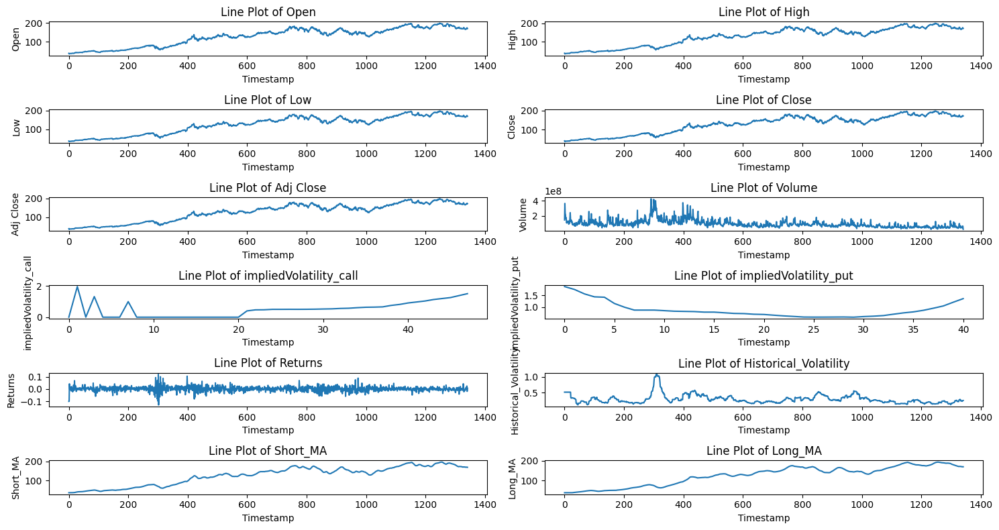
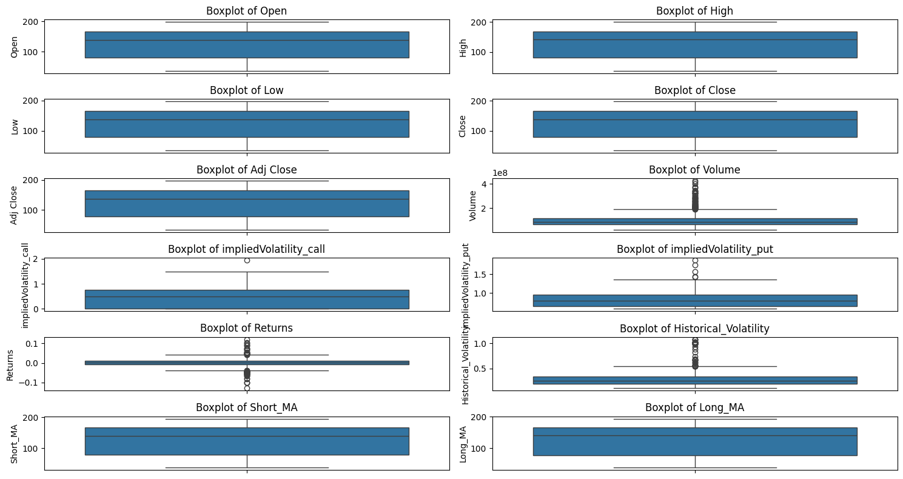
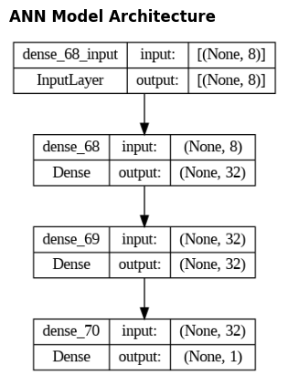
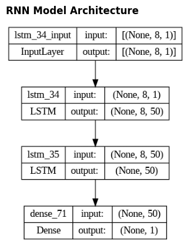
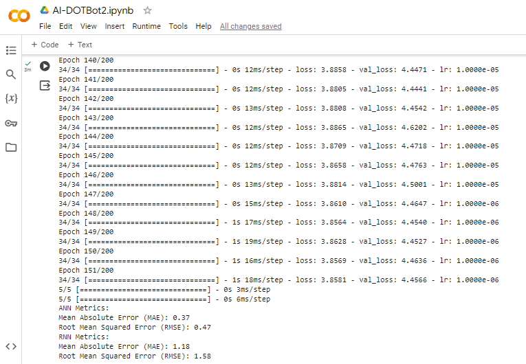
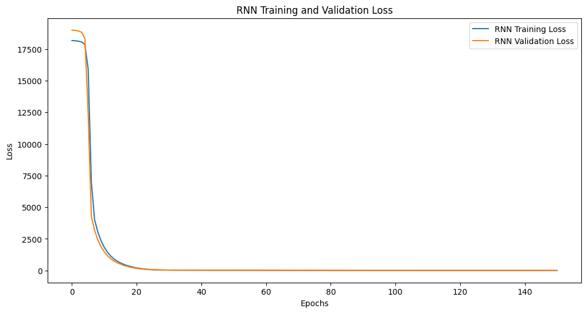
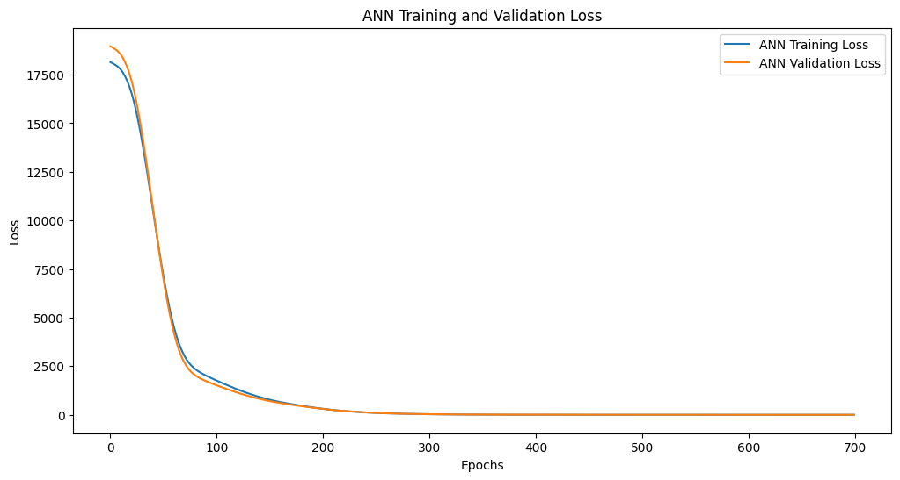
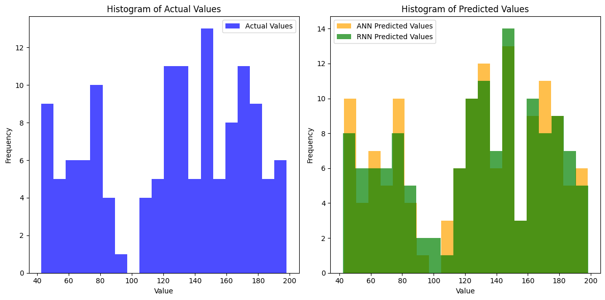
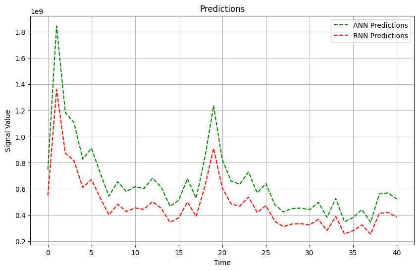
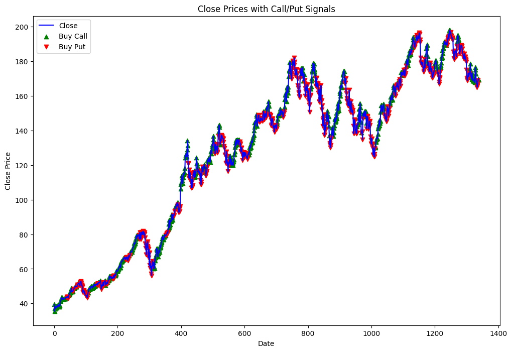

# 🤖 AI-DOT-BOT

**Artificial Intelligence Driven Options Trading Bot**

AI-DOT-BOT incorporates advanced deep learning models such as **Artificial Neural Networks (ANN)** and **Recurrent Neural Networks (LSTM)** to predict closing prices of options contracts with high precision. The system integrates powerful optimization techniques and follows a full machine learning pipeline — from data preprocessing to real-time signal generation.

📝[Ready Tensor Publication](https://app.readytensor.ai/publications/ai-dot-artificial-intelligence-driven-options-trading-bot-jojuSlCdBrvw)

---

## 🧠 Key Features

- **Advanced Model Architectures**: Combines ANN for stability and RNN (LSTM) for sequence learning.
- **Data Preprocessing**: Includes normalization, noise/outlier detection, and feature scaling.
- **Evaluation Metrics**: Tracks **MAE** (Mean Absolute Error) and **RMSE** (Root Mean Squared Error).
- **Visualization Tools**: Generates rich visual insights — learning curves, histograms, buy/sell plots, and more.
- **Signal Generation**: Automatically identifies buy/sell points based on predicted prices.
- **Optimizations**:
  - Adam Optimizer
  - StandardScaler
  - ReLU Activation
  - L1 & L2 Regularization
  - Reduce LR on Plateau
  - Early Stopping

---

## 📊 Visual Results & Analysis

### 🔹 Line Plot and Box Plot (After Preprocessing)

Visualize the spread, noise, and outliers in the raw data using:
- **Line Plot** to detect temporal anomalies
- **Box Plot** to detect outliers and variability

---

### 🔹 Model Architectures: ANN and RNN

Visual representations of the neural networks used.

---

### 🔹 MAE and RMSE Evaluation

Model performance comparison:

| Metric | ANN | RNN |
|--------|-----|-----|
| MAE    | 0.37| 1.18|
| RMSE   | 0.47| 1.58|

> Over 700 epochs, ANN shows a steady loss reduction (from 18,146 to 0.83), while RNN drops from 18,159 to 3.85 in 200 epochs. ANN achieves superior generalization, with lower validation loss (0.8663) compared to RNN (4.4566), confirming its predictive strength.

---

### 🔹 Learning Curves

Smooth decreasing losses indicate strong generalization and minimal overfitting.

---

### 🔹 Histogram: Actual vs Predicted Values

Compare distribution overlap between predicted and actual outcomes.

> A high degree of overlap shows strong model alignment with true values. Gaps may hint at underperforming regions.

---

### 🔹 Model Comparison: Predictions Over Time

Shows both models' predicted outputs vs actual closing prices.

> ANN generally yields higher confidence scores, but both exhibit consistent trends.

---

### 🔹 Buy/Sell Signals Overlay

Generated signal plot showing:
- ✅ **Green Triangle** = Buy Call
- 🔻 **Red Triangle** = Buy Put

> Clear signal alignment with underlying stock movements enhances trader confidence and backtest clarity.

---

## ⚙️ How to Use

1. **Data Preparation**:
   - Clean the data and normalize using `StandardScaler`
2. **Model Training**:
   - Train ANN and RNN separately using provided hyperparameters and callbacks
3. **Prediction & Evaluation**:
   - Predict closing prices and assess accuracy using MAE and RMSE
4. **Signal Generation**:
   - Convert predictions into buy/sell signals using defined thresholds
5. **Visualization**:
   - Use built-in plot functions to verify model and signal behavior

---

## 🛠 Requirements

- Python 3.x
- TensorFlow/Keras
- Scikit-learn
- Pandas
- Matplotlib / Seaborn

---

